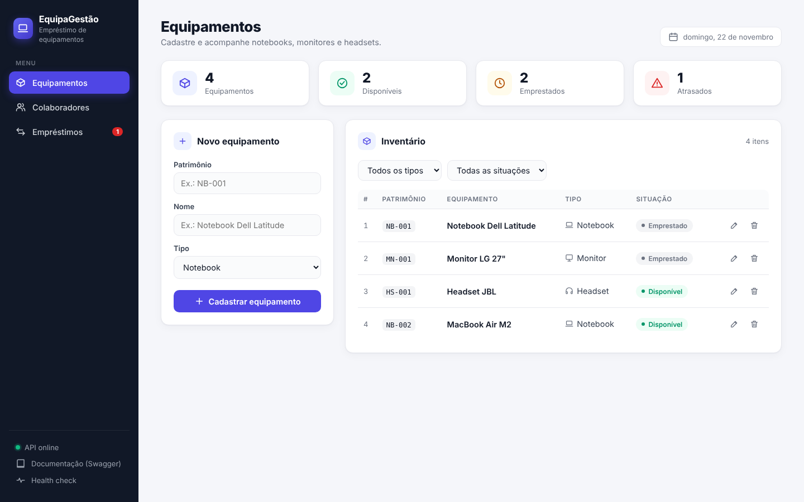
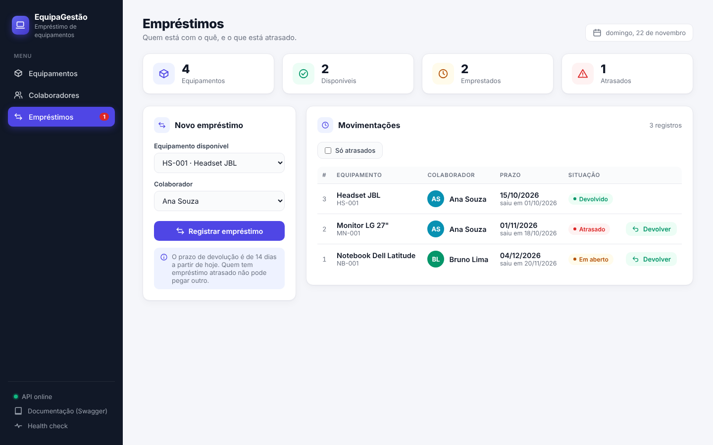

# Sistema de Empréstimo de Equipamentos

Projeto 2 do **ElasTech**, bootcamp de tecnologia para mulheres do **PagBank** em parceria com a **SoulCode Academy**.

Uma empresa empresta equipamentos (notebooks, monitores, headsets) pras pessoas colaboradoras, e o controle era feito numa planilha: ninguém sabia direito quem estava com o quê nem o que estava atrasado. Esse projeto resolve isso com uma API REST em Java + Spring Boot e uma tela web pra usar no navegador.

**Tela:** https://SEU-PROJETO.onrender.com/
**API:** https://SEU-PROJETO.onrender.com/equipamentos
**Swagger:** https://SEU-PROJETO.onrender.com/swagger-ui/index.html

> No plano grátis do Render, o serviço dorme depois de 15 minutos parado. A primeira requisição pode levar quase um minuto pra responder.

## Telas





## Tecnologias

- Java 17
- Spring Boot 3 (Web, Data JPA, Actuator)
- H2 (banco em memória)
- JUnit 5
- springdoc-openapi (Swagger)
- HTML, CSS e JavaScript puro na tela, separados em `src/main/resources/static` (`index.html`, `css/style.css`, `js/app.js`)
- Docker + Render (deploy)

## Como rodar

Precisa de Java 17 e Maven (ou abrir no IntelliJ e rodar `EmprestimosApplication`).

```bash
mvn spring-boot:run
```

Depois é só abrir:

- Tela: http://localhost:8080/
- Swagger: http://localhost:8080/swagger-ui/index.html
- Console do H2: http://localhost:8080/h2-console (JDBC URL `jdbc:h2:mem:emprestimos`, usuário `sa`, sem senha)
- Health: http://localhost:8080/actuator/health

Testes:

```bash
mvn test
```

## Rotas

### Equipamentos

| Método | Rota | O que faz | Sucesso |
|---|---|---|---|
| GET | `/equipamentos` | Lista (filtros opcionais `?tipo=NOTEBOOK` e `?disponivel=true`) | 200 |
| GET | `/equipamentos/{id}` | Busca um | 200 |
| POST | `/equipamentos` | Cadastra | 201 |
| PUT | `/equipamentos/{id}` | Atualiza nome e tipo | 200 |
| DELETE | `/equipamentos/{id}` | Remove (se nunca foi emprestado) | 204 |

### Colaboradores

| Método | Rota | O que faz | Sucesso |
|---|---|---|---|
| POST | `/colaboradores` | Cadastra | 201 |
| GET | `/colaboradores` | Lista | 200 |
| GET | `/colaboradores/{id}` | Busca uma pessoa | 200 |
| GET | `/colaboradores/{id}/emprestimos` | Histórico de empréstimos da pessoa | 200 |

### Empréstimos

| Método | Rota | O que faz | Sucesso |
|---|---|---|---|
| POST | `/emprestimos?equipamentoId=1&colaboradorId=2` | Empresta | 201 |
| GET | `/emprestimos` | Lista todos (`?atrasados=true` só os atrasados) | 200 |
| GET | `/emprestimos/{id}` | Busca um | 200 |
| PUT | `/emprestimos/{id}/devolucao` | Registra a devolução | 200 |

## Regras de negócio

| Regra | Descrição | Onde está |
|---|---|---|
| R1 | Patrimônio não se repete | `EquipamentoService.cadastrar` |
| R2 | Equipamento novo sempre nasce disponível | `EquipamentoService.cadastrar` |
| R3 | E-mail de colaborador não se repete | `ColaboradorService.cadastrar` |
| R4 | Só empresta equipamento disponível | `Equipamento.emprestar` |
| R5 | Ao emprestar: indisponível, data de hoje, prazo de 14 dias | Construtor do `Emprestimo` + `EmprestimoService.emprestar` |
| R6 | Não devolve duas vezes | `Emprestimo.devolver` |
| R7 | Ao devolver: data de hoje e equipamento disponível de novo | `Emprestimo.devolver` + `EmprestimoService.devolver` |
| R8 | Atrasado = não devolvido e prazo já passou (calculado na hora) | `Emprestimo.estaAtrasadoEm` + `EmprestimoRepository` |
| R9 | Equipamento com histórico não pode ser removido | `EquipamentoService.remover` |
| R10 | Quem tem empréstimo atrasado não pega outro | `EmprestimoService.emprestar` |

## Testes unitários

`EquipamentoTest` (3 casos) e `EmprestimoTest` (7 casos), com JUnit 5 puro, sem banco.

## Bônus feitos

- **Tela web**: front em HTML/CSS/JS servido pelo próprio Spring Boot, com resumo (total, disponíveis, emprestados, atrasados), filtros e histórico por pessoa
- **Swagger** (`/swagger-ui/index.html`)
- **Actuator** (`/actuator/health`, usado como Health Check Path no Render)
- **Tratamento de erros** com `@RestControllerAdvice`: 404 pra recurso que não existe, 409 pra R1, R3, R4, R6, R9 e R10, 400 pra dados inválidos

## Deploy

Deploy no Render com o `Dockerfile` da raiz (Java 17). A variável de ambiente `SPRING_H2_CONSOLE_ENABLED=false` desliga o console do H2 em produção.

## Autora

Sofia Mayumi Brandão Nakamaru · [GitHub](https://github.com/sofianaka)
